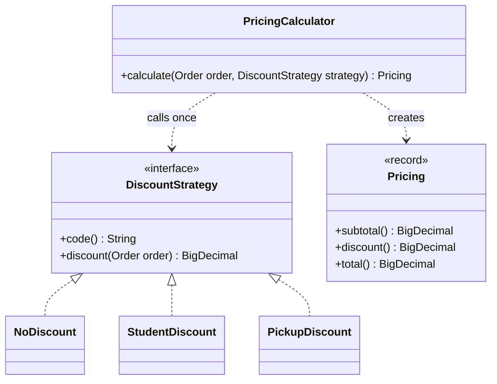
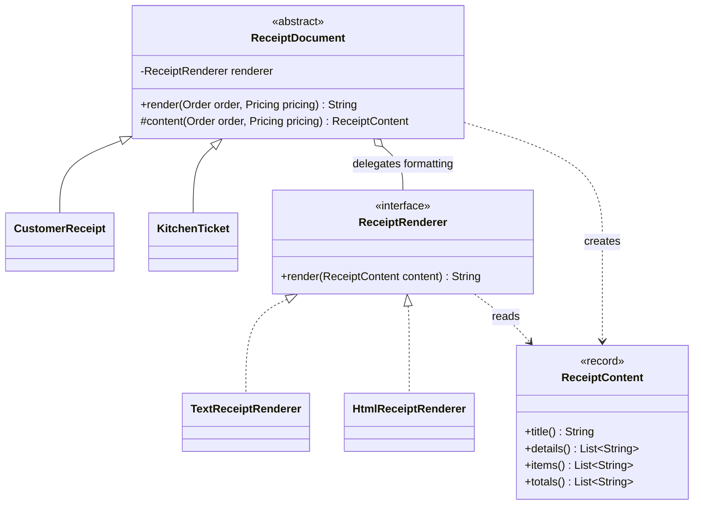

# Akmaral: Strategy and Bridge

These two patterns extend Anuar's Factory Method and Builder. A factory creates meals, the builder assembles an order, Strategy calculates its price, and Bridge renders a receipt. The implementation is plain Java 21 with no additional dependencies.

## Strategy: choosing a discount

`DiscountStrategy` defines `code()` and `discount(Order)`. The latter returns the **discount amount**, not the final price.

| Class | Code | Rule |
| --- | --- | --- |
| `NoDiscount` | `NONE` | No discount |
| `StudentDiscount` | `STUDENT` | 10% of subtotal |
| `PickupDiscount` | `PICKUP` | 20% of subtotal, only for `TAKEAWAY` |

`PricingCalculator` calls the selected strategy once and returns an immutable `Pricing` record containing `subtotal()`, `discount()` and `total()`. It rejects a missing discount or an amount outside the range from zero to subtotal. `PICKUP` on a dine-in order throws `IllegalArgumentException` with an explanation.

Money uses `BigDecimal`, two decimal places and `HALF_UP`. The discount is rounded before subtracting it from subtotal. For example, a 4000.00 KZT order with `STUDENT` has a 400.00 discount and a 3600.00 total. For a 0.05 subtotal, the same strategy rounds 0.005 to 0.01, leaving 0.04 payable.

`Order` and its builder do not select or store a strategy. `Order.total()` retains its original meaning: the amount **before discounts**, equal to `Order.subtotal()`. Use **`Pricing.total()`** when displaying the amount payable. Calculating again does not compound discounts or change the order.



## Bridge: document purpose and output format

The two independent choices are:

- **Document:** `CustomerReceipt` shows quantities, line prices and all pricing totals; `KitchenTicket` shows quantities, service mode, table and note, without prices.
- **Renderer:** `TextReceiptRenderer` produces plain text; `HtmlReceiptRenderer` produces an HTML fragment for a page.

`ReceiptDocument` receives a `ReceiptRenderer` through its constructor. Each document builds a `ReceiptContent`; the renderer only formats that content. `ReceiptContent` copies its lists so that they cannot change after construction. Both documents include order/customer details and any topping labels supplied by `OrderLine`.

All four combinations work. There are no classes such as `HtmlCustomerReceipt` or `TextKitchenTicket`: adding a format does not require another class for every document. HTML escapes dynamic strings, including names, notes, meal names and topping labels. Text output keeps the original text.



## Integration for Mukhammad

Build the order with the existing `MenuCatalog`, `OrderLine` and `Order.Builder`. Choose one strategy and calculate pricing for that same order:

```java
import com.restaurant.bridge.abstraction.CustomerReceipt;
import com.restaurant.bridge.abstraction.KitchenTicket;
import com.restaurant.bridge.implementation.HtmlReceiptRenderer;
import com.restaurant.bridge.implementation.TextReceiptRenderer;
import com.restaurant.strategy.concrete.StudentDiscount;
import com.restaurant.strategy.context.Pricing;
import com.restaurant.strategy.context.PricingCalculator;
import java.math.BigDecimal;

Pricing pricing = new PricingCalculator().calculate(order, new StudentDiscount());
String html = new CustomerReceipt(new HtmlReceiptRenderer()).render(order, pricing);
String text = new KitchenTicket(new TextReceiptRenderer()).render(order, pricing);
BigDecimal amountToPay = pricing.total();
```

`NoDiscount` and `PickupDiscount` are in the same `strategy.concrete` package. Pass pricing calculated from the order being rendered; `Pricing` does not carry an order ID. The HTML result is a fragment, so the future page supplies its layout and styles.

For Decorator integration, wrap a `Meal` before adding it to `OrderLine`. `price()` should include the extras; topping labels alone do not change the price. Strategy then uses the resulting order subtotal, and receipts read each line through the existing `Meal` interface. Observer can use the receipt API when reacting to an order event. No observer, decorator or web server is implemented here.

## Design choices

- **SRP:** strategies decide the discount, the calculator produces pricing, documents choose receipt content, and renderers format it.
- **OCP:** a new discount implements `DiscountStrategy` without changing the calculator. A new renderer can be used by both existing documents.
- **LSP:** either renderer accepts the same `ReceiptContent` contract and can be substituted for the other.
- **ISP:** `DiscountStrategy` and `ReceiptRenderer` expose only the operations their callers need.
- **DIP:** the calculator uses `DiscountStrategy`; documents use `ReceiptRenderer`, rather than depending on a particular implementation.
- **KISS / DRY:** common receipt details are assembled in `ReceiptDocument`; money stays in `Pricing` and the calculator. There is no extra framework or class for every document/format combination.

## Verification

Run `./mvnw verify` (Windows: `mvnw.cmd verify`) and `java -jar target/hearth-and-table-1.0.0.jar` with JDK 21.

`PricingCalculatorTest` covers every discount, eligibility, rounding, invalid amounts, one strategy call and unchanged order totals. `ReceiptTest` covers all four Bridge combinations, the discounted customer total, kitchen details, HTML escaping and immutable receipt data. Both suites use the existing Factory and Builder. `Main` preserves Anuar's demonstration and then shows all three strategies and all four receipt combinations.
