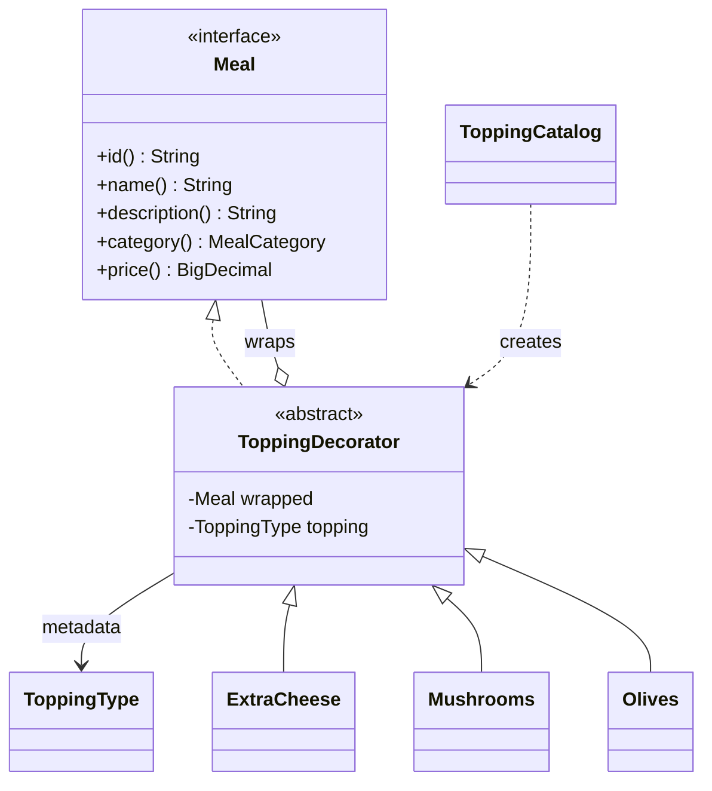
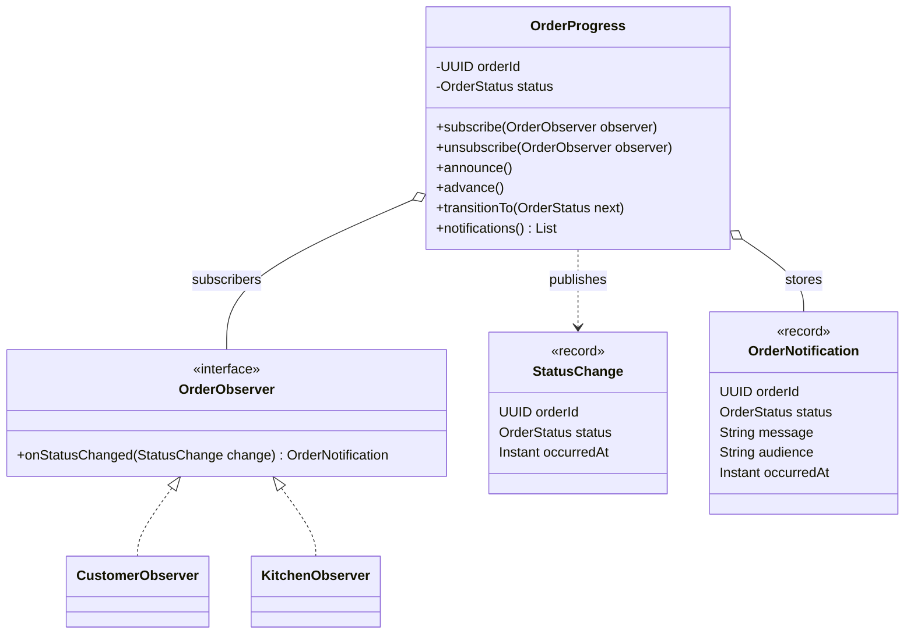

# Mukhammad — Observer, Decorator, and ITALIANO website integration

This work extends the current `sdp_final` foundation through its existing
public contracts. Anuar's Builder/Factory and Akmaral's Strategy/Bridge remain
the participants in the application flow. The implementation branch is
`feature/mukhammad-3d-interface`.

## Implementation commits

- `8c41231` — Decorator implementation and tests.
- `f70398d` — Observer implementation and tests.
- `2a12537` — Web integration, cinematic design, and documentation.

- `b577270` — Aituria identity and concise interface copy.
- `0e48a73` — Sculpted bronze emblem and browser icons.

These commits were published under `Vertex-blip` on
`feature/mukhammad-3d-interface`. [PR #1](https://github.com/arynttai/sdp_final/pull/1)
contains the integration; the GitHub Actions run for `0e48a73` passed.
The interface cleanup is tracked in [PR #2](https://github.com/arynttai/sdp_final/pull/2)
on `feature/mukhammad-refine-interface`, preserving the original dark hero artwork.
The English ITALIANO identity, light/dark themes, and final submission report are
developed on `feature/mukhammad-italiano-themes` from the merged project history.

## Decorator

`decorator.component.ToppingDecorator` implements `Meal` and holds another
`Meal`. The concrete `ExtraCheese`, `Mushrooms`, and `Olives` wrappers add their
metadata-defined names and prices while delegating ID and category. The wrapped
product remains unchanged; wrappers can wrap other wrappers. Drinks are rejected
by the common constructor.

`ToppingType` defines the names, IDs, and prices: cheese 350 KZT, mushrooms 300
KZT, and olives 300 KZT. `ToppingCatalog` maps IDs to constructors, publishes
the menu metadata, and validates up to three distinct known topping IDs.



Decorator chooses combinations at runtime through object composition. Although
the concrete toppings inherit shared wrapper behavior, there is no subclass
for every pizza/topping combination. The existing builder accepts the decorated
`Meal` through the same interface. Two Margheritas with cheese cost 4700 KZT
before discounts; Akmaral's STUDENT strategy deducts 470 KZT, producing 4230 KZT.

## Observer

`observer.api.OrderObserver` receives an immutable `StatusChange` and returns
an in-app `OrderNotification`. `KitchenObserver` and `CustomerObserver` respond
with different messages for the same order/status/time. Both notifications
retain that event's order ID and timestamp; they do not copy the customer name,
table, note, or receipt.

`OrderProgress` owns mutable progress separately from `Order`. The application
subscribes the two observers before `announce()` publishes `PLACED`. Valid
advances are `PREPARING`, `READY`, and `COMPLETED`. A repeated requested current
status returns without publishing; skipped/backward transitions, another
announcement, and advancing past completion are rejected. Subscription uses a
set, so registering the same observer instance twice does not duplicate delivery.
Unsubscribing one instance leaves other subscribers active and preserves history.



Observer publication happens synchronously inside Java when progress changes.
Browser refresh only reads already-recorded events. That delivery mechanism
does not replace the subject/subscriber relationship. The subject knows the
observer interface; its implementation does not refer to concrete subscribers.

## Integration and web boundary

`builder.application.OrderService` orchestrates `MenuCatalog`, `ToppingCatalog`,
`Order.Builder`, `PricingCalculator`, `OrderProgress`, and the Bridge documents.
Quotes construct a temporary immutable order and calculate through the same
pricing path without storing an order. Placement stores the immutable order,
calculated `Pricing`, progress, and original request in `StoredOrder`.

`builder.application.dto` exposes menu/quote/order representations.
`builder.web.OrderController` exposes health, menu, quote, placement, list,
read, demo advance, explicit status, and receipt endpoints. HTTP validation and
the exception handler return useful client errors. The receipt endpoint wraps
the existing HTML fragment in a document; both Bridge abstractions and renderers
retain their original roles. The amount payable always comes from `Pricing.total()`.

Each HTTP session owns one `builder.repository.OrderBook`, limited to 20 orders.
A synchronized lookup checks `requestId` before construction and subscription:
same request returns the existing order, changed payload with that ID conflicts.
Concurrent retries cannot create a second order or extra placement events.
The session lookup also protects status changes and receipts. API responses are
not cached; session cookies are HttpOnly with SameSite=Lax. Orders are lost on
session expiration (60-minute timeout) or process restart. This is a demo with
no real payment, restaurant submission, SMS, or email service.

The six production packages remain `builder`, `factory`, `strategy`, `bridge`,
`observer`, and `decorator`. `Main` is the only Java source directly under
`com.restaurant`; web infrastructure lives under `builder` to satisfy that course
layout. Domain products and pattern contracts do not depend on HTTP. The normal
Boot JAR runs the website; `--demo` preserves the original team demonstration
and adds a complete six-pattern walkthrough without starting a server.

## Design implementation

`static/index.html`, `styles.css`, `theme.js`, and `app.js` implement an English
restaurant interface with dark espresso and light ivory themes. The supplied
ITALIANO wordmarks switch with the theme, which is saved locally and applied
before the stylesheet loads. The original floating-pizza artwork is retained.
Food photographs, clear prices, categories, and a persistent basket support
ordering. English menu labels come directly from the server. Product
dialogs place the base price, toppings, quantity, and total beside a large photo.
The six menu photographs use 1600-pixel-wide variants of their original sources.
The basket and order views use server-provided options, prices, totals, status
sequence, and notifications.

The hero uses the original artwork as a static image with a responsive crop.
Repeated restaurant captions, slogans, ornamental rules, motion controls, and
duplicate status labels were removed. Orders use a compact list with one current
status, item prices, total, and a customer receipt. Native disclosures contain
customer history; nested demo controls preserve kitchen notifications,
all remaining receipt formats, and the demo status action. Expanded sections
survive refresh and status changes, and keyboard focus follows the status action.
Functional form labels, price information, and the checkout demo notice remain.
The stylesheet defines one responsive layout with theme color tokens. HTML
receipts use a validated light/dark parameter through the web wrapper; the Bridge
renderer, CSP, and escaped document content retain their existing contracts.
Printed receipts use light paper colors.

Menu photography is illustrative; its source URLs and Unsplash license reference,
along with the generated hero and logo artwork's provenance, are recorded in
[`images/CREDITS.txt`](../src/main/resources/static/images/CREDITS.txt).
Font families originate from Google Fonts and are served as local font files,
with their upstream SIL Open Font Licenses included for
[`Bricolage Grotesque`](../src/main/resources/static/fonts/OFL-BricolageGrotesque.txt)
and [`DM Sans`](../src/main/resources/static/fonts/OFL-DMSans.txt).
Screenshots and browser results are recorded after the full ordering flow has
been checked; the current verification status is stated below.

## SOLID and practical tradeoffs

- **SRP:** wrappers add topping behavior; observers form audience messages;
  the subject validates progress; the application coordinates; HTTP adapters
  handle requests and responses.
- **OCP / DIP:** the builder consumes `Meal`, and the subject consumes
  `OrderObserver`. New implementations can be added through those contracts.
- **LSP / ISP:** toppings retain the small `Meal` contract and preserve its
  identity/category; the observer contract has one callback.
- **DRY:** enum metadata drives topping prices and menu labels; server pricing
  and Bridge rendering are reused for quote, order, and receipt behavior.
- **KISS:** immutable values and a bounded session book meet the demo's needs
  without adding persistence or external notification infrastructure.

## Verification status

The integration run of `./mvnw verify` passed **63 tests**, with zero failures,
errors, or skips. Existing team tests were retained. New coverage includes:

- `decorator.ToppingDecoratorTest`: composition, wrapping order, metadata,
  identity/category, unchanged base products, invalid topping selections,
  drinks, quantities, and the 4700/470/4230 pricing example.
- `observer.OrderProgressTest`: both audiences for each status, duplicate
  subscription, rejected transitions, idempotent current status, unsubscribe,
  immutable history snapshots, and independent subjects.
- `builder.RestaurantApiTest`: quote/order/receipt agreement, repeat requests,
  concurrent idempotency, transitions, session isolation, receipt escaping,
  input validation, session capacity, both receipt themes, and invalid theme rejection.
- `builder.PackageLayoutTest`: exactly six pattern packages and one root entry
  point with matching source paths.

```sh
./mvnw verify
java -jar target/hearth-and-table-1.0.0.jar --demo
java -jar target/hearth-and-table-1.0.0.jar
```

Open `http://localhost:8080` for the website. Chromium checks passed on desktop
and at a 390 × 844 mobile viewport. The flow covered filtering, searching,
keyboard dialog open/close, topping selection, cart editing and removal,
dine-in table validation, order placement, status updates, and all four receipt
views. Two cheese-topped Margheritas produced 4,700 KZT subtotal, 470 KZT student
discount, and 4,230 KZT total. An identical creation retry returned the same
order; a second session could not see it. Network-error recovery passed.
Fresh-page checks found no JavaScript errors or failed resources, and neither
layout overflowed horizontally.

Both themes also passed checks at 320, 768, and 1024 pixels.
English labels and prices, image activation, modal base prices, checkout fields,
and HTML receipts are included in the two-theme verification. Order disclosures
retain their state through refresh and
status changes, with keyboard focus preserved; multiple orders and long
names/notes wrapped without overflow.

Screenshots: [desktop menu](screenshots/desktop-menu.png),
[mobile menu](screenshots/mobile-menu.png),
[desktop order](screenshots/desktop-orders.png), and
[mobile order](screenshots/mobile-orders.png),
[desktop dish options](screenshots/desktop-dialog.png), and
[mobile dish options](screenshots/mobile-dialog.png). Light-theme captures are
in [screenshots/light](screenshots/light). Theme persistence, cross-tab changes,
and unavailable browser storage were checked without losing checkout data.
The [final report](../output/pdf/ITALIANO-Final-Report.pdf) includes all six
patterns and the integration UML. Individual Moodle submissions and the oral
defense remain student actions.

## Defense explanation

“My Decorator wraps a Meal to add toppings while preserving its interface,
identity, and category. The existing Builder and Strategy therefore calculate
the decorated order without special topping branches. My Observer keeps
mutable status outside the immutable order and notifies subscribed customer
and kitchen observers through a small interface. The website reads the real
Java results, while the same order and pricing feed the team's Bridge receipts.
Tests verify composition, valid transitions, retries, and session isolation.”
